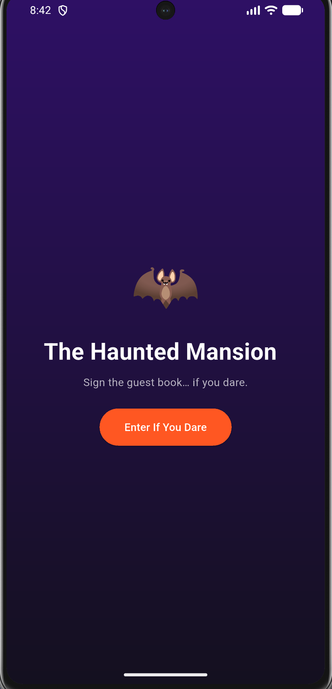
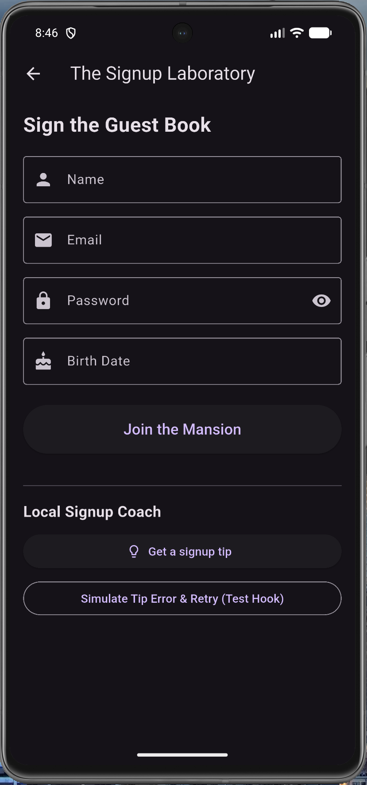
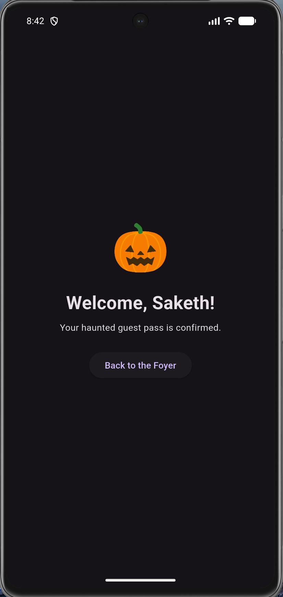

# The Haunted Signup Mansion (Activity 11)

MAD 4360 | Saketh Sagar Kokkireni and Sai Athota | Undergraduate track

A three-screen Flutter app: Foyer (`welcome_screen.dart`) -> Laboratory (`signup_screen.dart`) -> Ballroom (`success_screen.dart`). `main.dart` only builds `MaterialApp` and names the Foyer as `home`.

Run it with `flutter pub get` then `flutter run`.

## Screenshots

| Foyer | Signup Lab | Ballroom |
|---|---|---|
|  |  |  |

## How navigation works

The Foyer opens the Lab with `Navigator.push`, so the Foyer stays underneath and Back from the Lab returns to it. After a valid submit, the Lab uses `Navigator.pushReplacement` to swap itself for the Ballroom. The stack becomes `[Foyer, Ballroom]`, so Back from the Ballroom can never reopen a submitted form. The Ballroom's own button calls `popUntil(route.isFirst)` to walk home to the Foyer.

## Where state lives and when it dies

The name travels to the Ballroom through the `SuccessScreen(userName: ...)` constructor, so it is just a final field on the widget and lasts as long as that screen. The typed form values live in `TextEditingController`s inside `_SignupScreenState`, and the birth date and password-visibility flag are plain State fields. All of it dies when the Lab is removed from the stack, which is why pushReplacement (or Back to the Foyer) gives a fresh empty form next time.

## dispose() and the async gap

Each `TextEditingController` in the Lab and the `ConfettiController` in the Ballroom is disposed in `dispose()`, otherwise they would keep listeners alive after the screen is gone. `_submit()` waits 2 seconds with `Future.delayed`, and the user could leave during that wait. That is the async gap, so the code checks `if (!mounted) return;` before navigating, and the same guard sits in `_fetchSignupTip`. Without it, we would call `setState` or `Navigator` on a dead State.

## Testing log

Results come from tracing each case through the committed code in `lib/screens/`.

| # | Test | Expected | Result |
|---|---|---|---|
| 1 | Tap Join with every field empty | Four errors: name, email, password, birth date | Pass: "Please enter your name / email / a password" and "Pick your birth date" |
| 2 | Email `abc` and password `12345` | Email and password errors | Pass: email must contain "@"; password must be at least 6 characters |
| 3 | Tap the eye icon | Password shows and hides | Pass: `_obscurePassword` flips, icon swaps between visibility and visibility_off |
| 4 | Empty birth date, everything else valid | Submit blocked | Pass: `_birthDate == null` fails validation, no spinner starts |
| 5 | Back from the Lab | Lands on Foyer, typed values gone | Pass: Lab State is disposed, next visit is an empty form |
| 6 | Back from the Ballroom | Lands on Foyer, never the form | Pass: stack is `[Foyer, Ballroom]` after pushReplacement |
| 7 | Double-tap Join during the spinner | Exactly one Ballroom | Pass: first tap sets `_submitting`, button `onPressed` becomes null |
| 8 | Arrive at the Ballroom | Confetti fires once for 3 seconds | Pass: `_confetti.play()` in `initState`, controller disposed on exit |

Date picker boundaries (`firstDate` 1920, `lastDate` today, `initialDate` 2008):

| Input | Expected | Result |
|---|---|---|
| Open picker | Opens on 2008, no error | Pass |
| Pick 6/15/2000 | Field shows 6/15/2000 | Pass |
| Pick today | Accepted | Pass |
| Tomorrow | Greyed out | Pass |
| Pick 1/1/1920 | Accepted | Pass |

Bugs found: none in the shared flow. One thing worth knowing is that `_submitting` is never reset to false, which is fine with `pushReplacement` but would leave a frozen Join button if the Lab ever stayed on the stack (see Ghost Hunt answer 1).

## Activity 10 answers (carried over)

1) How is the local tip selected?
   The local tip is selected programmatically by looking up a fixed category constant (password_help) in an on-device map database (_tipDatabase). This ensures the logic is structured and deterministic without needing hardcoded string checks or network requests.
2) What is one privacy choice made in this implementation?
   All form data and tip lookups are processed entirely on-device with zero network requests or telemetry tracking. This protects user privacy by ensuring that sensitive inputs like passwords and emails never leave the local device.